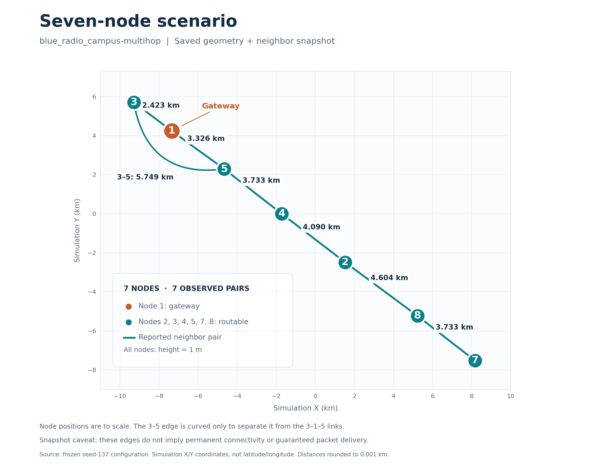

# Seven-node scenario

The plot shows the saved `blue_radio_campus-multihop` geometry and the frozen seed-137 neighbor snapshot.

- Node positions are to scale in simulation X/Y coordinates, in kilometres. These are not latitude/longitude coordinates.
- Distances label the straight-line separation between nodes, rounded to 0.001 km. All nodes have a height of 1 m.
- Node 1 is the gateway. The other node IDs are 2, 3, 4, 5, 7 and 8. The saved numbering is preserved; this snapshot has no node 6.
- The seven lines represent reported neighbor pairs in this snapshot. They do not imply permanent connectivity or guaranteed packet delivery.
- The 3–5 link is curved only for legibility, to separate it from the 3–1–5 links. Its labelled 5.749 km distance is the straight-line separation, not the length of the drawn curve.

This is a documentation figure, not a new simulation run or a change to the scenario configuration.
